# eisy-ai User Guide

This is a start-to-finish walkthrough: installing eisy-ai, configuring it, opening it for the
first time, and then using everything it can do in both of its modes. For the compact
configuration reference, see [README.md](README.md); for the full field-by-field config
reference, see [POLYGLOT_CONFIG.md](POLYGLOT_CONFIG.md).

---

## Table of contents

1. [Installation](#1-installation)
   - [1.1 Install eisy-ai](#11-install-eisy-ai)
   - [1.2 Configure eisy-ai](#12-configure-eisy-ai)
   - [1.3 Open eisy-ai](#13-open-eisy-ai)
2. [Usage](#2-usage)
   - [2.1 eisy-ai knows where you are](#21-eisy-ai-knows-where-you-are-navigation)
   - [2.2 Sessions](#22-sessions)
   - [2.3 Modes: Customer vs. Developer](#23-modes-customer-vs-developer)
   - [2.4 Customer mode](#24-customer-mode)
   - [2.5 Developer mode](#25-developer-mode)

---

## 1. Installation

### 1.1 Install eisy-ai

eisy-ai is a plugin, so it's installed the same way as any other eisy plugin, from eisy-ui.

1. Open eisy-ui in a browser, go to the plugin **Store**, and from the menu choose **eisy Plugins**.
> 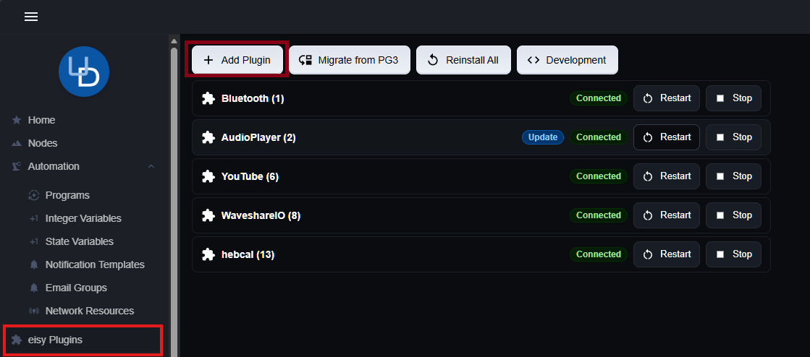


2. Click the **Add Plugin** button, search for **eisy-ai**, and click it, followed by **Activate** `and` then **Install**.
> 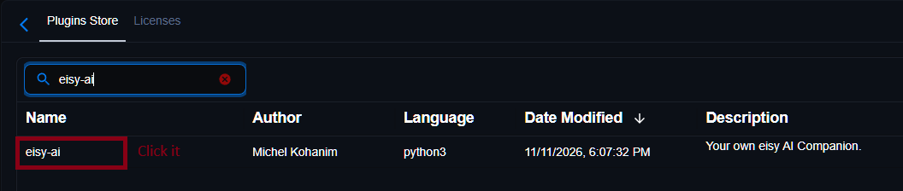

> 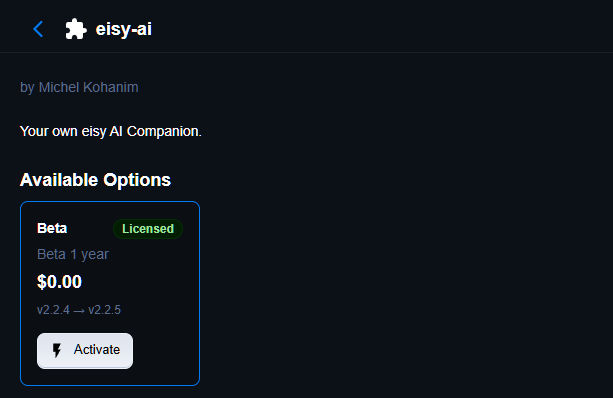

3. Wait for the install to finish. eisy-ai will appear in your installed plugins list once it's
   done.

> 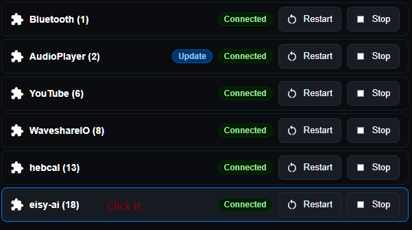

At this point eisy-ai is installed but not yet usable — it needs your LLM provider's API key
before it can actually hold a conversation.

### 1.2 Configure eisy-ai

eisy-ai talks to an LLM provider you bring yourself (Claude, OpenAI, Gemini, Grok, or a local
llama.cpp-compatible server), so have that provider's API key ready before you start.

1. Click on eisy-ai in the Plugins list and then click on the Configuration tab.

> 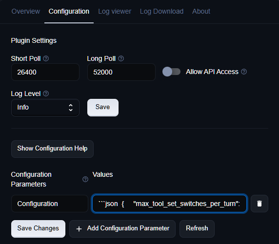

2. Paste in a configuration block and replace the placeholder API key with your own. Here's a
   minimal working example using Claude for both modes (see [README.md](README.md#configuration)
   for what each field means, and [POLYGLOT_CONFIG.md](POLYGLOT_CONFIG.md) for every option):

   ```json
   {
     "max_tool_set_switches_per_turn": 1,
     "search_engine": null,
     "search_engine_api_key": null,
     "mcp_server": false,
     "nucore_runtime": {
       "unified": {
         "enabled": true,
         "provider": "claude",
         "model": "claude-haiku-5-5",
         "api_key": "Replace_with_your_Anthropic_API_Key",
         "stream": true,
         "max_turns": 20,
         "max_tokens": 64000,
         "max_iterations": 20
       },
       "plugin_authoring": {
         "enabled": true,
         "provider": "claude",
         "model": "claude-sonnet-5-5",
         "api_key": "Replace_with_your_Anthropic_API_Key",
         "stream": true,
         "max_turns": 20,
         "max_tokens": 64000,
         "max_iterations": 50
       }
     }
   }
   ```

   `unified` is the profile behind customer mode; `plugin_authoring` is the profile behind
   developer mode. You can give each one a different provider or model — for example, a
   faster/cheaper model for everyday customer requests and a stronger one for plugin authoring.
   Either profile can be turned off entirely by setting its `enabled` to `false`, as long as at
   least one profile stays on.

3. Click on the `Save Changes` button, then restart the eisy-ai plugin from eisy-ui for the new configuration to take effect.

> **No API key configured?** eisy-ai will show a plain notice that web chat and plugin authoring need a key before they'll work. Add one and restart to clear it.

### 1.3 Open eisy-ai

Once configured, eisy-ai is reachable from the eisy-ai icon shown at the top of eisy-ui.

> 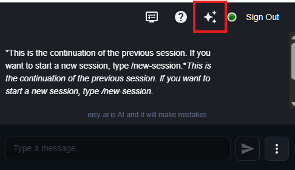

Click it to open the chat window. Every `new` conversation starts in **customer mode** — see

---

## 2. Usage

### 2.1 eisy-ai knows where you are (navigation)

Two things work together here:

- **It can use what's on your screen to resolve what you mean.** If your wording is ambiguous —
  "turn it off" with no clear antecedent — eisy-ai can use the device, scene, or routine you
  currently have open as a hint to figure out which one you meant. It's only ever a hint, never
  treated as something you actually typed: if what you ask is unambiguous on its own, or the
  thing on your screen doesn't match a real device/scene/routine, eisy-ai ignores it rather than
  guessing wrong.
- **Its replies link straight to the thing they're about.** Whenever eisy-ai mentions a specific
  device, scene, folder, routine, or plugin in a reply, that mention is a clickable link that
  takes you directly to that item's own screen in the eisy UI — not a plain-text name you'd have
  to go find yourself. For example, if you ask "what does my Away Mode routine do?" the reply
  names **Away Mode** as a link that opens that routine's own screen; a device it mentions opens
  that device's screen; a plugin it mentions opens that plugin's dashboard or store page. You
  don't need to do anything to get this — it's automatic whenever eisy-ai references something
  specific it already knows the real identity of. It never invents a link to something it isn't
  sure about.

### 2.2 Sessions

As long as you're signed in, each mode (customer and developer) keeps its own conversation
history, and — separately — can hold more than one *named* session, the way browser tabs or
documents do. Your current session keeps growing as you talk and survives reconnecting (and, on
installations with persistent session storage turned on, a full restart of eisy-ai itself).

Manage sessions by sending a message containing *only* the command below (plus an id/name where
needed):

| Command | What it does |
|---|---|
| `/sessions` | Lists your saved sessions in the current mode, marking which one is current. |
| `/new-session` | Starts a fresh, empty session. Your previous one isn't lost, just no longer active. |
| `/load-session <id>` | Switches to a saved session by id, replaying its history. |
| `/rename-session <id> <name>` | Gives a saved session a memorable name. |
| `/delete-session <id>` | Removes a saved session (starts a fresh one in its place). |
| `/delete-all-sessions` | Removes every saved session in the current mode, then starts fresh. |
| `/compact-session` | Summarizes older turns right away to free up room. |

Customer and developer mode sessions are entirely separate — `/sessions` and the other commands
only ever act on whichever mode you're currently in. If a session command says session
management "isn't enabled on this installation," turn on persistent session storage in your
configuration (see [1.2 Configure eisy-ai](#12-configure-eisy-ai)).

As a long conversation grows, you may see an automatic note like *"Session history is at 70% of
its budget..."* — you can run `/compact-session` right away, or just keep going; it will
summarize older turns for you once it's actually full.

> **How much history a session holds before compacting is configurable.** Each profile's `history_token_budget` setting (see [POLYGLOT_CONFIG.md](POLYGLOT_CONFIG.md)) controls this — it's a soft token budget, independent of the turn-count cap. A larger budget means a session can run longer before eisy-ai needs to compact it, but it also means every turn later in that session carries more history along with it, which costs more per turn as the session grows.You set this per profile (`unified`/`plugin_authoring`) in your own configuration, so you can give customer mode and developer mode different compaction behavior if you want.

### 2.3 Modes: Customer vs. Developer

eisy-ai has two modes:

- **Customer mode** — control and understand your smart home: devices, scenes, routines,
  plugins, day-to-day troubleshooting. This is where every conversation starts.
- **Developer mode** — build, test, and publish your own eisy plugins.

**Switching modes.** Two ways, and they behave differently:

- **Just ask.** Say what you want — "I'd like to build a plugin for my pool controller," or
  from developer mode, "turn off the living room lights" — and eisy-ai switches for you,
  mid-conversation. There's a limit of one automatic switch per message by default; a request
  that would need more than that gets a plain explanation instead, so just split it across a
  couple of messages.
- **Type the command directly.** Send a message containing *only* `/developer` or `/customer` to
  switch immediately. This switch is **sticky** — it stays in effect until you switch again.

One important consequence either way: **the two modes don't share conversation history.** When a
switch happens because you asked for something, eisy-ai carries over a short summary of your
request so you don't have to repeat yourself — but nothing beyond that summary comes with you.
Switching with the explicit `/developer`/`/customer` command carries over no summary at all.

If a mode isn't enabled on your installation, switching to it fails with a plain explanation.

### 2.4 Customer mode

Everything here works through ordinary conversation — describe what you want, and eisy-ai
figures out which capability to use.

> **A quick safety note.** Deleting a device, scene, folder, routine, variable, or installed plugin always previews first, and only goes through if your very next reply is exactly the word `YES` — "yes," "sure," and "go ahead" don't count. A few other actions (removing a device from a scene, running a live scene test, restarting a service, buying/installing a plugin, changing plugin settings) also wait for your explicit go-ahead, just without the strict `YES`.

#### Command, control & status

- *"Is the porch light on?"* / *"What's the temperature in the den?"* — check current device
  state, one device or several in a single question.
- *"Turn off the kitchen lights."* / *"Set the thermostat to 68."* — control one or many devices
  at once.
- *"What can the thermostat actually do?"* — look up everything a device or scene supports,
  including valid ranges and choices.
- *"Rename the office lamp to 'desk lamp.'"* / *"Move this device into the Upstairs folder."* —
  organize your devices (folders are purely organizational, with no automation of their own).
- *"Create a scene with the porch light as controller and the entry light as a responder."* —
  build scenes/groups, including direct device-to-device links.
- *"What happens when I run my 'Movie Night' scene?"* — get a plain explanation of exactly which
  devices respond and how.

#### Automation & routines examples

- *"Build a routine that turns on the porch light at sunset and off at 11pm."* — pair conditions
  (device status, button press, schedule, sunrise/sunset, another routine's state, a variable,
  a utility signal) with actions (control devices, wait, repeat, adjust a scene, send a
  notification, change a variable, control another routine).
- *"What does my 'Away Mode' routine actually do?"* — get a plain-language explanation plus its
  live status (enabled/disabled, currently running, last/next run time).
- *"Turn off my 'Away Mode' routine."* / *"Run 'Good Night' right now."* — enable/disable, run
  immediately, stop, toggle run-at-startup, or delete a routine.
- *"Add a 'Vacation' folder for my away-related routines and move 'Away Mode' into it."* —
  organize routines into folders.
- *"Create a variable called GuestMode, starting at 0."* — small counters/flags your routines
  can use as conditions or results.

> One thing worth knowing: editing an existing routine rewrites its whole logic rather than patching one piece, so describe the complete behavior you want — eisy-ai reviews the current version first so nothing you didn't ask to change gets dropped.

#### Diagnostics examples

Reach for these when something's actually broken — everyday "what's the temperature" questions
are answered by ordinary status checks, not these tools.

- *"I turn on the porch light but nothing happens."* — investigates commands from eisy-ai not
  reaching the device.
- *"I flipped the switch by hand and eisy-ai never noticed."* — investigates the device's status
  not making it back.
- *"Why doesn't my scene turn everything off?"* — runs a real test: eisy-ai fires an actual "off"
  command to the group and reports which members responded (only after you agree — currently
  Insteon scenes only).
- *"Why did the garage light turn on last night?"* / *"How often does the back door open?"* /
  *"Why didn't my pool pump run last night?"* / *"Is there any pattern for my thermostat for
  the last 3 months?"* — checks the standing activity log, answering both simple "what
  happened" questions and aggregate ones (counts, trends, patterns over a stretch of time); if
  it can't find an automated cause, it says so rather than guessing.
- *"Is everything healthy?"* — checks which wireless subsystems (Insteon/Z-Wave/Zigbee/Matter)
  are enabled and connected, firmware/software versions, and whether updates are available.
- *"Restart the ISY service."* — checks/starts/stops/restarts a core service (only after you
  agree, since it briefly interrupts it).

> There's also a broad, advanced escape hatch — running a command directly on the host computer — for technical requests nothing else covers. It's genuinely powerful and unrestricted, so eisy-ai explains what a command does before running anything that changes or restarts something.

### 2.5 Developer mode

Developer mode walks you through building a real, working eisy/IoX plugin end to end,
conversationally: researching the target device or service, defining how it shows up as a node,
generating the actual plugin code, testing it on a real eisy, debugging it in VS Code, and
pushing it to GitHub. Switch into it as described in [2.3](#23-modes-customer-vs-developer)
above.

> **Three rules that apply across the whole workflow:**
> - Generating a plugin only ever touches your local disk — nothing changes on a real eisy until you explicitly install it.
> - Secrets never get written into generated code. An OAuth `client_id`/`client_secret` is  always a placeholder at generation time; you set the real values after install.
> - Deleting a plugin's registration or an installed plugin previews first, then requires your very next reply to be the literal word `YES`.

#### Navigating the Development tab

Click the **Development** tab in eisy-ui.

> 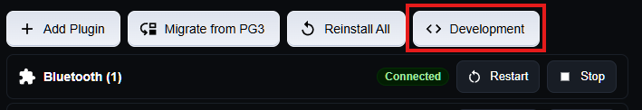

There are two sections here:

1. **Local Plugins** — plugins installed locally that aren't published to the store. Everything you build with eisy-ai in developer mode lives here: it's stored locally on eisy and installed directly from eisy into its own sandbox environment, never touching the store.

   Although eisy-ai manages all of your plugin's configuration for you, clicking on it here lets
   you configure its settings manually, and even watch it build and update its code right in
   front of your eyes.

   > 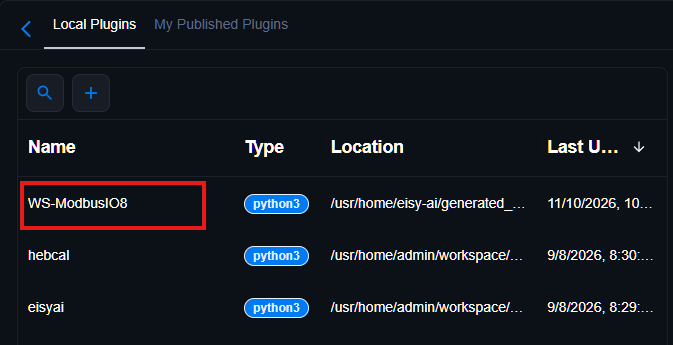

   > 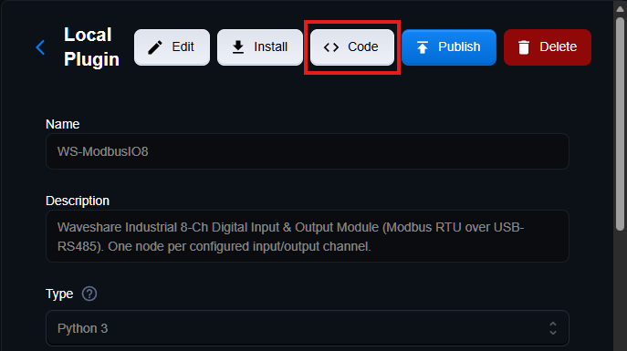

   > 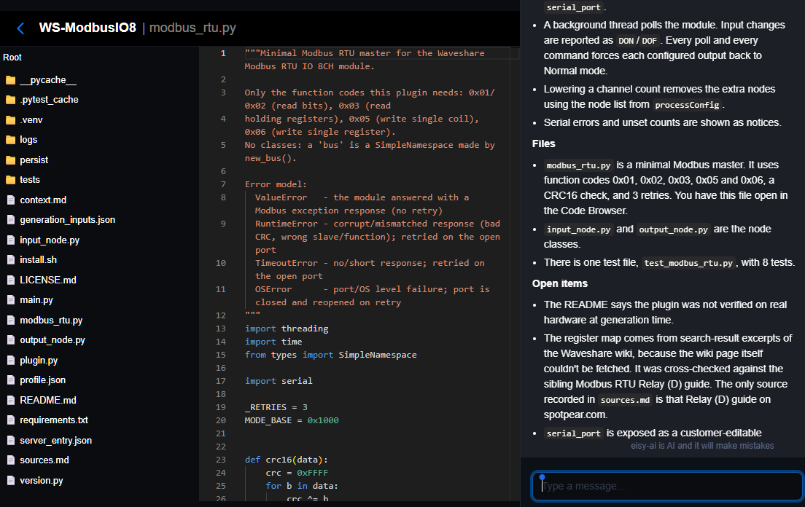

2. **My Published Plugins** — if you're a vetted developer, this is where you take a plugin from Local Plugins and publish it to the official store, optionally earning money by selling it.

> **Want to publish and sell your plugins?** Becoming a vetted developer is required before you can publish to the store. Contact us at [universal-devices.com/my-tickets](https://www.universal-devices.com/my-tickets) to get started.


#### Prompting eisy-ai in developer mode

Think of this as a conversation that moves through the following stages — you don't need to
name each tool, just describe what you want at each point and eisy-ai drives the workflow:

1. **Set up your developer identity (once per workspace).** The first time you use developer
   mode, eisy-ai asks for your email, display name, and optionally a GitHub URL — this gets
   stamped into every plugin you generate. It won't ask again once this is on file, and won't
   overwrite it without you asking to change it.
2. **Describe the device or service you want to support.** *"I want to build a plugin for my
   SimpliSafe alarm."* eisy-ai checks the plugin store first (and recommends stopping there if a
   plugin already covers it), then searches GitHub and the web for the device's own API docs or
   an existing reference implementation. This research step is a hard prerequisite — generation
   refuses without it.
3. **Define how the device shows up.** eisy-ai proposes properties, commands, and settings UI for
   the device (its "Dynamic Profile"), looking up standard property/unit ids rather than
   inventing new ones where a standard one exists. You can keep refining this in plain language —
   *"actually, make the target temperature a range from 60 to 90"* — before anything is
   generated.
4. **Generate the plugin.** *"Looks good, generate it."* — this produces the actual plugin
   directory: Python code, registration file, requirements, install script, README/LICENSE, a
   starter test suite. If files already exist, you'll see what would conflict before anything
   is overwritten.
5. **Install and test it on your real eisy.** *"Install it."* — registers, installs, and starts
   the plugin, reporting each stage separately. From here you can ask it to check status, read or
   write its configuration, start/stop/restart its service, or call its own features — the same
   tools a customer-facing conversation would use.
6. **Debug, push to GitHub, and package for the store** — covered in detail below.

#### Setting up GitHub

eisy-ai automates the local git side of publishing your plugin, but **it never creates a GitHub
repository on your behalf** — that part is deliberately left to you.

1. **Create a GitHub account**, if you don't already have one, at
   [github.com/join](https://github.com/join).
2. **Create a new, empty repository** for your plugin (no README, license, or `.gitignore` —
   eisy-ai writes its own). Copy its URL (e.g. `https://github.com/yourname/your-plugin.git`).
3. **Make sure eisy itself can authenticate to GitHub.** eisy-ai's push is plain `git push`, so
   eisy needs SSH access to your repository. The easiest way is to ask eisy-ai to set it up:
   *"Set up GitHub access for https://github.com/yourname/your-plugin.git, my GitHub email is
   you@example.com."* This writes a real private key plus SSH config on eisy, so it only runs
   once you've explicitly agreed. You must be signed in, and the GitHub email you give has to
   match the email you're signed in with (otherwise it stops and tells you how to fix that,
   since over SSH there's no other way to confirm whose account it is). It then:
   - Creates a key used only for that one repository (a GitHub *deploy key*, the default). Say
     so if you'd rather have one key for your whole GitHub account instead (an *account key*,
     which reaches every repository you own, not just this one).
   - Trusts GitHub's host key, only after verifying its fingerprint against GitHub's own
     published one, and tests the connection.
   - Gives you the public key, a suggested title (`eisy - <your eisy's hostname>`, or your own if
     you asked for one), and exact steps for the one part it can't do: adding the key on
     GitHub.com. For a deploy key: open the repository's own **Settings** → **Deploy keys** →
     **Add deploy key**, paste the key, and tick **Allow write access** (or the push will be
     rejected). For an account key instead: your account's **Settings** → **SSH and GPG keys** →
     **New SSH key**, paste the key there.
   - Once you've added it, ask eisy-ai to try again — it verifies the connection and, now that
     it succeeds, gives you the SSH form of your repository's URL (`ssh_remote_url`) to use in
     step 4 below.

   It's safe to ask again at any time; if access already works it changes nothing.

   **Prefer to do it by hand?** An SSH key is the simplest option, and since you talk to eisy-ai
   through chat rather than a terminal, you generate and read it by asking eisy-ai to run the
   commands for you (this is the same host-shell capability described under
   [Diagnostics](#diagnostics-examples) in customer mode; nothing special needs to be enabled for
   it in developer mode). These are the same steps eisy-ai automates above:

   1. **Check whether eisy already has a key.** Ask: *"Run `ls -la ~/.ssh` for me."* If you
      already see an `id_ed25519`/`id_rsa` pair listed, skip to sub-step 3.
   2. **Generate a new key pair on eisy**, with no passphrase (there's no interactive prompt to
      type one into later, since eisy-ai runs commands non-interactively):

      > *"Run this for me: `ssh-keygen -t ed25519 -C "your-email@example.com" -f ~/.ssh/id_ed25519 -N ""`"*

      This writes a private key (`~/.ssh/id_ed25519`, which never leaves eisy) and a public key
      (`~/.ssh/id_ed25519.pub`, safe to share — this is the one that goes to GitHub).
   3. **Ask eisy-ai to show you the public key:** *"Run `cat ~/.ssh/id_ed25519.pub` and show me
      the output."* Copy the single line it returns (starts with `ssh-ed25519`).
   4. **Add it to your GitHub account:**
      - On GitHub.com, click your profile photo → **Settings** → **SSH and GPG keys** (in the
        left sidebar, under "Access") → **New SSH key**.
      - Give it a **Title** that identifies this eisy (e.g. `eisy - living room`), leave
        **Key type** as `Authentication Key`, and paste the public key you copied into the
        **Key** field.
      - Click **Add SSH key** (GitHub may ask you to re-enter your password or 2FA code to
        confirm).
   5. **Pre-trust GitHub's host key**, so the first real push doesn't hang waiting for an
      interactive "are you sure you want to continue connecting?" prompt that eisy-ai's
      non-interactive shell tool can never answer:

      > *"Run `ssh-keyscan -t ed25519 github.com >> ~/.ssh/known_hosts` for me."*
   6. **Test the connection:** *"Run `ssh -T git@github.com` and show me the result."* A
      successful setup replies with something like *"Hi yourname! You've successfully
      authenticated, but GitHub does not provide shell access."* — that message is expected and
      means authentication worked.
   7. **Use the SSH form of your repository's URL** (not the `https://` one) so git actually uses
      this key: `git@github.com:yourname/your-plugin.git` instead of
      `https://github.com/yourname/your-plugin.git`.

   > Prefer HTTPS instead? The alternative is a personal access token  ([github.com/settings/tokens](https://github.com/settings/tokens)) stored in git's own credential store on eisy — ask eisy-ai to run `git config --global credential.helper store` once, then the first push will prompt for your username and the token as the password and remember it after that. SSH is generally simpler here precisely because it needs no stored password at all.
4. **Ask eisy-ai to push your plugin**, giving it the `ssh_remote_url` step 3 handed back (for a
   deploy key it looks like `git@github.com-yourname-your-plugin:yourname/your-plugin.git`; for
   an account key or the manual steps, `git@github.com:yourname/your-plugin.git`): *"Set up the
   GitHub repo at `<that ssh_remote_url>`."* From there it will:
   - Run `git init` (skipped if the plugin directory is already a repo).
   - Write a `.gitignore` that guarantees your local secrets file (`.iox_env`) is never
     committed.
   - Make the first commit, using your developer identity from step 1 of "Prompting" above.
   - Add your repository URL as the `origin` remote and push.

   This only happens with your explicit go-ahead, and is safe to run again later — it skips
   anything already done. If you forget the remote URL, eisy-ai tells you to create the empty
   repo yourself and re-ask with its URL.
5. **Everyday git work** (status, diffs, log, stashing, pulling, ad hoc commits) isn't a special
   eisy-ai feature — just run ordinary git commands in your plugin's directory, or ask eisy-ai to
   run them for you via its shell-command tool.

#### VS Code integration

Once your plugin is installed on a real eisy, ask eisy-ai to set up debugging — e.g. *"set up VS
Code debugging for this plugin."* It will:

1. Read the live credential (`PG3INIT`) the installed service is actually running with, and write
   it to a local `.iox_env` file in your plugin's directory — the exact same credential the live
   service uses, so a debugger attached locally behaves identically to the real thing.
2. Write a `.vscode/launch.json` debug configuration pointing at your plugin's `main.py` and
   loading that `.iox_env` file.

3. Open your plugin's folder in VS Code, open the **Run and Debug** panel, select the generated configuration, and start debugging — you can now set breakpoints and step through your plugin's code while it runs against the real eisy.

> 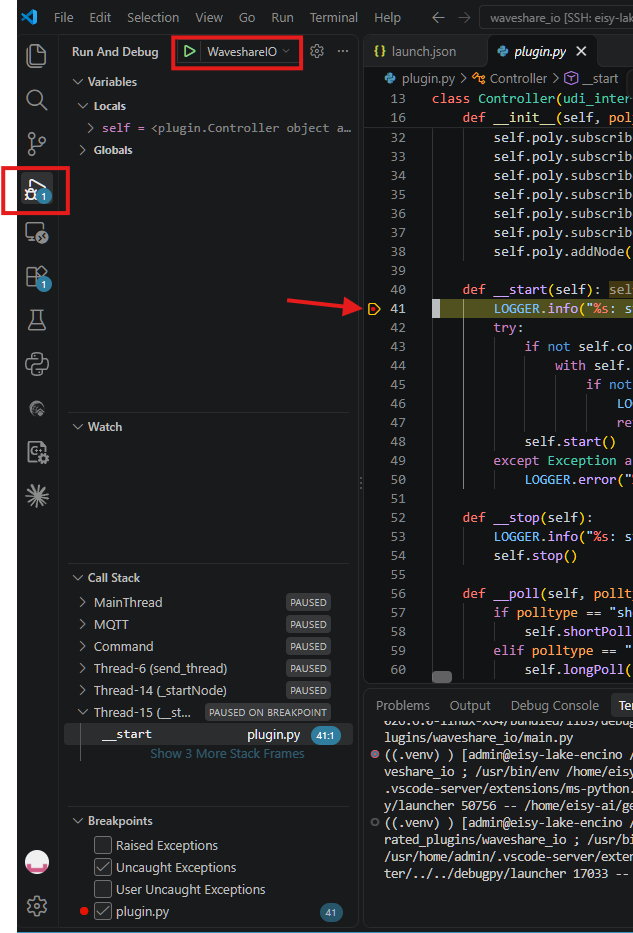

This credential rotates every time the live service actually restarts, so it's safe (and sometimes necessary) to redo this step after a restart — just ask again and both files get rewritten.

#### Remote VS Code support

Beyond debugging from your own machine, eisy-ai can also set up your eisy itself to accept a
direct **VS Code Remote-SSH** connection, so you can open your plugin's files and run VS Code's
own tooling right on the hub instead of only attaching a debugger to it remotely.

The first time you ask for VS Code setup (see above), eisy-ai also offers this one-time, hub-side
step: installing the packages and environment VS Code's Remote-SSH extension needs on your eisy.
Because this makes a real change on the hub itself, it always asks for your explicit
confirmation first — it won't do this silently as a side effect of the local debug setup above.

Once you confirm, eisy-ai runs the hub-side setup and gives you a ready-to-use SSH config
snippet, built from your eisy's own real address and name, for example:

```
Host eisy-lake
    HostName 192.168.1.50
    User admin
    SetEnv BASH_ENV=".bash_linux"
```

1. Add that block to your own machine's `~/.ssh/config` file.
2. In VS Code, install the **Remote - SSH** extension if you haven't already.
> 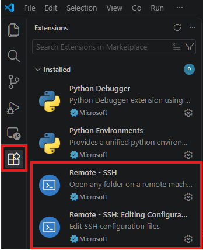

3. Open VS Code's Remote-SSH host picker and connect to `eisy-lake` (or whatever name your snippet used).

> 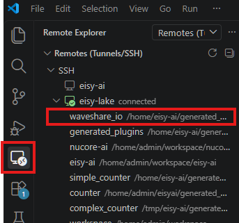

4. Once connected, open your plugin's folder directly on eisy-lake — you're now running VS Code against the real filesystem and Python environment your plugin executes in, not a local copy.

This eisy-side setup only needs to be done once per plugin output root; eisy-ai tracks that it's already been done and won't ask again unless you explicitly ask it to redo it.

#### Packaging for the plugin store

Once your plugin works the way you want, ask eisy-ai to package it — e.g. *"package this plugin
for the store."* This builds a ready-to-share archive (code, profile, README, license,
requirements, install script) named after your plugin and its version, always leaving out
dev-only clutter (your local secrets file, certificates, debug configuration, test files,
persisted/session data) — and refuses outright if anything that looks like a real secret value
turns up in a file that would be included. Packaging is safe to redo any time; a new archive
replaces the old one. Actually submitting the archive to the plugin store is still a manual step
you do yourself.

> **Remember: submitting to the store requires being a vetted developer.** As noted under [Navigating the Development tab](#navigating-the-development-tab), you can package and test your plugin locally without any special status, but moving it from Local Plugins to **My Published Plugins** requires that vetting. If you haven't gone through that yet, contact us at  [universal-devices.com/my-tickets](https://www.universal-devices.com/my-tickets) first.